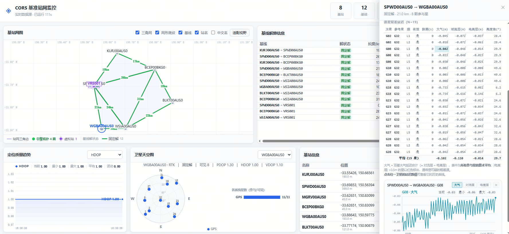

# CORS

**Network RTK / VRS software platform for Continuously Operating Reference Station networks.**

CORS connects to multiple physical GNSS reference stations, solves the baselines between them with multi-frequency RTK, estimates regional ionospheric and tropospheric differential corrections over a Delaunay-triangulated network, and generates Virtual Reference Station (VRS) observations in real time. The corrections are broadcast over NTRIP as standard RTCM 3.x messages, so rovers from any receiver brand obtain centimeter-level positioning.

The system is built for large-scale station networks (provincial or nationwide level) on an event-driven, high-concurrency architecture, with real-time integrity monitoring of stations, corrections and service quality. It runs on Linux and Windows.

**Highlights**

- Multi-constellation network RTK with baselines up to 300 km
- Real-time VRS generation and RTCM 3.x (MSM) broadcasting over NTRIP
- Delaunay-triangulated network with per-subnetwork atmospheric modelling
- Complete and self-contained: NTRIP client, NTRIP service and RTCM codec are all included
- Independent of receiver brand — standard RTCM 3.x in, standard RTCM 3.x out
- Real-time monitoring of station and service integrity

## Contents

- [Overview](#overview)
- [Technical specifications](#technical-specifications)
- [Features](#features)
- [How it works](#how-it-works)
- [Repository layout](#repository-layout)
- [Third-party components](#third-party-components)
- [Getting started](#getting-started)
- [Running the engine](#running-the-engine)
- [Post-processing and replay (`bin/postprc/`)](#post-processing-and-replay-binpostprc)
- [Configuration](#configuration)
- [Monitoring dashboard](#monitoring-dashboard)
- [Operations](#operations)
- [Documentation](#documentation)
- [Interfaces and platforms](#interfaces-and-platforms)
- [FAQ](#faq)
- [Availability](#availability)
- [Contact](#contact)
- [References](#references)

## Overview

CORS is a complete network RTK service platform. The full chain is implemented in this codebase — from station data ingestion, through orbit/clock processing, baseline solving and atmospheric modelling, to real-time VRS generation and correction broadcasting — with no external caster software required. All external interfaces follow open standards (RTCM 3.x, NTRIP, NMEA, RINEX), which keeps the system open to receivers of any brand on both the station side and the rover side.

Typical deployments include regional and nationwide CORS networks, surveying-grade RTK services, and collaborative networks where station owners contribute data and subscribers receive centimeter-level corrections. The engine scales with server resources rather than imposing fixed limits on the number of reference stations or simultaneous rover connections.

## Technical specifications

| Item                  | Specification                                                                                                                |
| --------------------- | ---------------------------------------------------------------------------------------------------------------------------- |
| Constellations        | BeiDou, GPS, GLONASS, Galileo, QZSS — multiple frequencies                                                                   |
| Station input         | NTRIP client; RTCM 2.x / 3.x messages                                                                                        |
| Correction output     | RTCM 3.x MSM over NTRIP — MSM4 / MSM6: GPS 1074/1076, GLONASS 1084/1086, Galileo 1094/1096, QZSS 1114/1116, BeiDou 1124/1126 |
| Network RTK baselines | Up to 300 km                                                                                                                 |
| Ambiguity resolution  | ≈97% fix rate within 300 km; ≈99% within 200 km                                                                              |
| Networking            | Delaunay triangulation with subnetwork-based computation                                                                     |
| Atmospheric modelling | Joint least-squares estimation of ionospheric and tropospheric differential corrections from multiple frequency combinations |
| Positioning           | Network RTK at centimeter level; precise orbit determination at centimeter level                                             |
| Synchronization       | Time synchronization of station observations; multi-GNSS time system conversion (BDT / GPS / Galileo / GLONASS)              |
| Monitoring            | Physical and virtual station integrity, coordinate stability, correction quality, regional model and RTK accuracy            |
| Architecture          | Event-driven asynchronous I/O; multi-process / multi-thread; lock-free queues; shared memory; high-performance hash tables   |
| Capacity              | No fixed station / rover limits; scales with server resources                                                                |
| Platforms             | Linux (server deployments) and Windows                                                                                       |
| Protocols             | NTRIP, RTCM, NMEA, RINEX                                                                                                     |

## Features

### Constellations and signals

- BeiDou, GPS, GLONASS, Galileo and QZSS, multiple frequencies
- RTCM 2.x / 3.x message decoding, RTCM 3.x (including MSM) encoding
- NTRIP, NMEA and RINEX protocol support

### Network RTK and VRS

- Multi-frequency combined network RTK baseline processing (dual-frequency, triple-frequency, etc.)
- Medium and long baselines: up to 300 km; ambiguity fixing rate of about 97% within 300 km and 99% within 200 km, including low-elevation satellites
- Fast and robust multi-strategy ambiguity resolution, with ambiguity closure checks over the triangulation
- Virtual Reference Station (VRS) technology: pseudorange and carrier-phase observations generated and broadcast in real time
- Network RTK differential positioning service; a rover can be routed automatically to the nearest virtual station based on its reported position
- Time synchronization of reference station observations

### Error modelling and products

- Delaunay triangulation based station networking, with subnetwork computation around a master station
- Atmospheric delay modelling: joint least-squares estimation of ionospheric and tropospheric differential corrections from multiple frequency combinations
- Multi-GNSS satellite orbit and clock computation with RAIM to detect and exclude anomalous satellites; time system conversion among BeiDou, GPS, Galileo and GLONASS
- GNSS precise orbit determination with centimeter-level accuracy; SSR correction generation

### Integrity monitoring

- Real-time monitoring of the observation quality of physical and virtual stations, ephemeris availability, regional ionospheric and tropospheric delays, and network RTK corrections
- Coordinate stability monitoring; single-station data quality analysis (cycle slip, signal quality, multipath)
- Accuracy monitoring of the regional error model and of RTK positioning

### Architecture and performance

- High-concurrency design: atomic locks with event notification, lock-free queues, multi-process and multi-thread processing, shared memory, high-performance hash tables
- Event-driven asynchronous I/O, built for large numbers of station connections
- Optimized network RTK computation efficiency
- Linux and Windows

## How it works


1. **Data acquisition.** Reference station streams are received over NTRIP — the engine acts as an NTRIP client towards your sources or an external caster — and decoded into observations and ephemeris.
2. **Satellite products.** Orbits and clocks are computed for all supported constellations; anomalous satellites are detected and excluded via RAIM; time systems are converted as needed.
3. **Networking and baselines.** Stations are organised into a Delaunay triangulation; baselines are solved with multi-frequency RTK, ambiguities are fixed, and inter-station ionospheric and tropospheric residuals are extracted. Ambiguity closure is checked across the triangulation.
4. **Atmospheric modelling.** For each subnetwork a master station is selected and the regional atmospheric delay model is estimated by least squares, so the differential ionospheric and tropospheric delays can be derived at any point of the subnetwork.
5. **VRS generation.** Virtual reference station observations (pseudorange and carrier phase) are generated for the user's position in real time.
6. **Broadcast.** The VRS corrections are broadcast to subscribed rovers over NTRIP as standard RTCM 3.x MSM messages. Rovers can also be routed automatically to the nearest virtual station based on their reported position.

Alongside the solution chain, the monitoring components continuously check station data quality, coordinate stability, ephemeris availability and model accuracy, for both physical and virtual stations.

### Service interfaces

| Port | Service              | Purpose                                                              |
| ---- | -------------------- | -------------------------------------------------------------------- |
| 9000 | Engine console (TCP) | Interactive command console; default, change with `-p`               |
| 8002 | NTRIP service        | VRS corrections to rovers, with user authentication from `agentuser` |
| 7999 | Monitoring service   | Station monitoring data (`monitor-port` in `cors.conf`)              |
| 8080 | Solution data stream | Continuous solution output for the dashboard / external consumers    |
| 8181 | Web dashboard        | Browser UI over HTTP / WebSocket, with a REST API                    |

Every service port speaks its standard protocol — the console accepts plain text commands, the NTRIP service speaks NTRIP, and automation can use the dashboard's HTTP API (see [Monitoring dashboard](#monitoring-dashboard)).

## Repository layout

Top-level directories:

| Path       | Description                                                                           |
| ---------- | ------------------------------------------------------------------------------------- |
| `src/`     | Engine and library source code (see module table below)                               |
| `include/` | Public headers: `cors.h`, `rtklib.h`, `options.h`, `vt.h`, `uve.h`, `log.h`           |
| `lib/`     | Bundled third-party libraries (see [Third-party components](#third-party-components)) |
| `conf/`    | Sample configuration files                                                            |
| `bin/`     | Prebuilt binaries: `linux/`, `win/`, `postprc/`                                       |
| `doc/`     | Documentation (see [Documentation](#documentation))                                   |
| `app/`     | Ready-to-run trial package for Windows x64                                            |
| `test/`    | Test programs, built with CMake                                                       |

Source modules (`src/`):

| Module     | Purpose                                                                                                       | Key files                                                                     |
| ---------- | ------------------------------------------------------------------------------------------------------------- | ----------------------------------------------------------------------------- |
| `engine`   | Engine entry point and interactive console                                                                    | `engine.c`, `mengine.c`                                                       |
| `cors`     | Solution core and service control                                                                             | `cors.c`, `ci.c`                                                              |
| `ntrip`    | NTRIP client (source ingestion), caster and agent (rover service)                                             | `ntripclient.c`, `ntripcaster.c`, `ntripagent.c`, `ntrip.c`                   |
| `rtcm`     | RTCM 2.x / 3.x message encoding and decoding                                                                  | `rtcm3.c`, `rtcm3e.c`, `encoder.c`, `decoder.c`                               |
| `nrtk`     | Network RTK and baseline RTK processing                                                                       | `nrtk.c`, `srtk.c`                                                            |
| `vrs`      | Virtual reference station observation generation                                                              | `vrs.c`                                                                       |
| `dtrignet` | Delaunay triangulation networking                                                                             | `dtrignet.c`                                                                  |
| `gpos`     | GNSS positioning library: RTK/PPP engines, ambiguity resolution, LAMBDA, ephemeris, SBAS, IONEX, geoid, tides | `rtkpos.c`, `pntpos.c`, `ppp.c`, `ar.c`, `lambda.c`, `ephemeris.c`, ...       |
| `pnt`      | Point positioning                                                                                             | `pnt.c`                                                                       |
| `ppp`      | Precise point positioning                                                                                     | `mppp.c`                                                                      |
| `monitor`  | Real-time monitoring of stations, corrections and service quality                                             | `monitor*.c`                                                                  |
| `rinex`    | RINEX observation handling                                                                                    | `rinex.c`                                                                     |
| `common`   | Shared utilities: options, logging, NMEA, solutions, virtual terminal                                         | `options.c`, `log.c`, `nmea.c`, `solution.c`, `vt.c`, `rtkcmn.c`, `province/` |


Prebuilt executables (`bin/linux/` and `bin/win/`; the replay tool ships separately in `bin/postprc/`):

| Executable | Role |
| --- | --- |
| `cors-engine` | Main engine: interactive console, service control, orchestration |
| `cors-ntrip` | NTRIP engine: caster, agent and stream recorder |
| `cors-rtcm` | RTCM encoding / decoding engine |
| `cors-srtk` | Baseline RTK solving engine |
| `cors-vrs` | VRS generation engine |
| `cors-postprc` | Replay tool for recorded station data — standalone Windows x64 package ([details](#post-processing-and-replay-binpostprc)) |

## Third-party components

| Component | Used for | License |
| --- | --- | --- |
| libuv | Asynchronous I/O and the event loop | MIT — `lib/libuv/LICENSE` |
| uthash | Hash tables | BSD-style, © Troy D. Hanson — header in `lib/uthash/uthash.h` |
| kdtree | Nearest-station spatial queries | BSD-style, © John Tsiombikas — `lib/kdtree/` |
| Triangle | Delaunay triangulation, © Jonathan Richard Shewchuk | see header in `lib/triangulator/triangle.c` |
| queue.h | Queue helper macros | see header in `lib/queue/queue.h` |
| draw | Lightweight software rendering and image I/O (`olive.c`, `sv.h`, `stb_image`) | see headers in `lib/draw/` |

License texts are kept in the respective headers and license files under `lib/`.

## Getting started

### Option A — Ready-to-run trial (Windows x64)

The `app/mcors-0.1.0-win64-beta/` package is a self-contained trial build of the engine with a web monitoring dashboard. No compiler and no Node.js installation are needed (the Node runtime is bundled inside the package).

1. Double-click `start.cmd`. The engine starts in its own console window (port 9000) and the dashboard opens at `http://localhost:8181/`.
2. The dashboard shows the station network map (Delaunay triangulation) and the baseline solution table. Type `help` in the engine console to list the available commands; `start-gui` reopens the dashboard at any time.
3. Double-click `stop.cmd` to stop the service.

Starting only one part:

| Command | Starts |
| --- | --- |
| `start.cmd` | engine + dashboard + browser (default) |
| `start.cmd engine` | engine only |
| `start.cmd dash` | dashboard only (the engine must already be running) |

To share the dashboard with other machines on the LAN, run `start-gui 8181 lan` in the engine console.

Ports used by the trial package:

| Port | Service |
| --- | --- |
| 9000 | Engine console (plain TCP text) |
| 8080 | Solution data stream (TCP) |
| 7999 | Station monitoring service |
| 8181 | Dashboard (HTTP / WebSocket, including the REST API) |

Practical notes:

- Configure your stations in `conf\ntripsources` using the format `name,host,port,user,password,mountpoint,lat,lon,height,type#`, then restart the engine. Stations can also be added at runtime from the dashboard or with the `addsource` console command — runtime stations are not persisted across restarts.
- `conf\agentuser` ships with sample NTRIP credentials (`test1/password`). Change them before any real deployment.
- While evaluating, the dashboard lets you verify the behaviour of the engine directly: baseline fix status (FIX / FLOAT), per-baseline satellite counts, ionospheric and tropospheric delay magnitudes, and overall station data health.
- See `app/mcors-0.1.0-win64-beta/README.txt` for details, and `app/mcors-0.1.0-win64-beta/doc/manual.html` for the full manual (English; Chinese edition: `manual.zh.html`).

### Option B — Prebuilt binaries

Ready-to-run binaries are provided for Linux (`bin/linux/`) and Windows (`bin/win/`), together with the static libraries used by the build. The post-processing tool is under `bin/postprc/`.

```
./cors-engine -o conf/cors.conf -t 3
```

The command reference for the engine is in `bin/README.md`. A standalone package in `bin/postprc/` replays recorded station data offline — see [Post-processing and replay](#post-processing-and-replay-binpostprc):

```
cors-postprc -o conf/cors_postprc.conf -s 2025:4:20:0:0:0
```

where `-s` sets the start time of the replay.

### Option C — Build from source

Prerequisites:

- CMake 3.16 or later
- GCC (Linux) or MinGW-w64 (Windows), with gfortran
- LAPACK and BLAS libraries — the top-level `CMakeLists.txt` expects them under `lib/lapack`; point that `add_subdirectory` at your own LAPACK/BLAS build if the directory is not present
- gfortran runtime libraries (`gfortran`, `quadmath`)
- On Linux: `sqlite3`, `m`, `pthread`
- libuv is bundled under `lib/libuv`

Build:

```
mkdir build && cd build
cmake ..
cmake --build . -j
```

On Windows, use a MinGW-w64 toolchain (`cmake -G "MinGW Makefiles" ..`).

The build produces the `cors` static library, the `cors-engine` executable (plus `cors-mengine`), and the test programs (`test_cors`, `test_dtrignet`, `test_rtcm_decoder`, `test_rtcm_encoder`, `test_rtkpos`, `test_bstas_nearest_range`).

## Running the engine

```
cors-engine -o conf/cors.conf -t 3 -p 9000
```

| Parameter | Description |
| --- | --- |
| `-o <file>` | Configuration file |
| `-t <level>` | Trace level: 1 error, 2 warning, 3 info |
| `-p <port>` | Console server port (default 9000) |
| `-m <mode>` | Advanced mode |
| `-s` | Start the service immediately on launch |
| `-d <dev>` | Console device |
| `-b <addr>` | Bind address — use `-b local` to restrict the service ports to the local host |

The engine starts an interactive console. Main commands:

| Command | Description |
| --- | --- |
| `start` / `shutdown` | Start / stop the service |
| `loadopt` | Load system configuration |
| `addsource` | Add a reference station source |
| `delsource` | Delete a source |
| `sourceinfo` | Show source status (`sourceinfo all` for all sources) |
| `navidata` | Show navigation data |
| `showbls` | Show baseline solutions |
| `showdtrigs` | Show the station Delaunay triangulation |
| `showsubnet` | Show the station subnetworks |
| `addvsta`, `delvsta`, `showvsta` | Add / delete / list virtual stations |
| `adduser`, `deluser`, `showusers` | Manage NTRIP users |
| `observ`, `satellite`, `monirtcm` | Inspect observations / satellite status / RTCM messages |
| `drawdtrignet`, `drawvsta` | Draw the triangulation / VRS-station maps |

`addsource` syntax:

```
addsource name IP port user,password mountpoint lat lon height type
```

For example:

```
addsource A001 127.0.0.1 8002 user,pass A001 37.64052108 116.92379211 63.876 M
```

where `type` is `M` (master: ephemeris + observation), `E` (ephemeris only) or `O` (observation).

Virtual stations are given as ECEF coordinates:

```
addvsta VRS001 -2149724.236 4410605.355 4061567.167
```

A minimal session:

```
> start
> addsource A001 127.0.0.1 8002 user,pass A001 37.64052108 116.92379211 63.876 M
> showdtrigs
> showbls
```

Tip: the console matches input by substring against the command table, so type the full command name (for example `start`, not a fragment that could match `start-gui`).

## Post-processing and replay (`bin/postprc/`)

`bin/postprc/` is a self-contained Windows x64 package that replays recorded reference station data through the engine's processing chain — decoding, network RTK baselines, atmospheric modelling, VRS generation and monitoring — taking its station input from a file instead of live connections. A complete network solution can therefore be reproduced and examined offline: useful for evaluating the engine against a fixed data set, regression-checking configuration changes, and demonstrating the VRS workflow without a live network. All required runtime DLLs are bundled.

Package contents:

| Item | Description |
| --- | --- |
| `cors-postprc.exe` | The replay tool |
| `conf/` | Sample configuration (see below) |
| `lib*.dll` | MinGW-w64 runtime libraries — keep them beside the executable |
| `readme.txt` | Usage note with the sample data download link |

The sample configuration is in `conf/cors_postprc.conf` — the same option set as `cors.conf`, with the recording as the station input:

```
ntrip-sources-file     = .\conf\ntripsources_postprc
virtual-stations-file  = .\conf\vrsstations
ntrip-record-file      = .\ntrip_record_20250420.dat
agent-user-file        = .\conf\agentuser
sourcetable-file       = .\conf\sourcetable
monitor-port           = 7999
```

`ntrip-record-file` points at the recording: the raw NTRIP streams of all reference stations in a single `.dat` file. Recordings of this kind are produced by the live engine when `ntrip-record-file` (and optionally `monitor-record-file`) is configured in `cors.conf`; the same file is then replayed here. The remaining files are the same working files as a live deployment — station list (`ntripsources_postprc`), virtual station list (`vrsstations`), NTRIP accounts (`agentuser`) and source table (`sourcetable`) — and the monitoring service runs on port 7999, matching the live engine.

Run it from the package directory:

```
cors-postprc.exe -o .\conf\cors_postprc.conf -s 2025:4:20:0:0:0
```

`-s` sets the start time of the replay (year:month:day:hour:minute:second); processing begins at that point of the recording.

Sample data set (referenced by the sample configuration):

- `ntrip_record_20250420.dat` — about three hours of 1 Hz reference station data
- Download: <https://pan.baidu.com/s/1vVVAsQUiu6s38APWQrCSCA> (access code: `ctxu`) — place the file next to `cors-postprc.exe`
- Station list in `conf/ntripsources_postprc` (seven stations); virtual station in `conf/vrsstations`; NTRIP accounts in `conf/agentuser`

Trace output follows the engine's usual naming scheme — `cors_engine_<timestamp>.postprc.trace`.

## Configuration

Main configuration files in `conf/`:

| File | Purpose | Format |
| --- | --- | --- |
| `cors.conf` | System configuration: paths of the files below, monitor port, optional record files | `key = value` |
| `ntripsources` | Reference station data sources | `name,host,port,user,password,mountpoint,lat,lon,height,type#` |
| `vrsstations` | Virtual station positions | `name,ECEF-X,ECEF-Y,ECEF-Z#` |
| `beselines` | Preferred baselines to solve | `STA1,STA2#` |
| `base-stations.info` | Station metadata: description, region, coordinates, ITRF frame, physical/virtual flag | `id,address,province,city,lat,lon,height,ITRF,type` |
| `agentuser` | NTRIP accounts for rover access | `user,password#` |
| `rtk.conf` | Baseline RTK solver options | RTKLIB-style options (`pos1-*`, `pos2-*`) |
| `pnt.conf` | Positioning options for the point-positioning component | RTKLIB-style options |
| `sourcetable` | NTRIP source table (STR records) served to clients — shipped in the trial package's `conf/` | standard NTRIP STR records |


Records in the comma-separated files are terminated with a trailing `#`; lines starting with `#` are comments.

A sample `cors.conf`:

```
ntrip-sources-file     = conf/ntripsources
baselines-file         = conf/beselines
base-stations-info-file= conf/base-stations.info
virtual-stations-file  = conf/vrsstations
rtk-conf-file          = conf/rtk.conf
agent-user-file        = conf/agentuser
monitor-port           = 7999
# optional: trace-file, ntrip-record-file, monitor-record-file, sourcetable-file
```

A sample `ntripsources`:

```
# name,host,port,user,password,mountpoint,lat,lon,height,type
A001,192.168.1.10,8002,Ntrip,password,A001,37.64052108,116.92379211,63.876,M#
A002,192.168.1.11,8002,Ntrip,password,A002,38.84052108,117.91379211,53.876,O#
```

A sample `vrsstations`:

```
VRS001,-2149724.236,4410605.355,4061567.167#
```

A sample `beselines`:

```
A001,A003#
```

A sample `agentuser`:

```
test1,password#
```

Most settings take effect when the engine (re)loads the configuration; RTK and positioning parameters can also be reloaded at runtime with the `loadopt` command.

## Monitoring dashboard

The trial package includes a web dashboard (the `mcors` front end) for day-to-day operation. The interface defaults to English and can be switched to Chinese from the top-right corner.



Panels:

- **Network map** — the station Delaunay triangulation and the live connection status of each station
- **Baseline solutions** — per-baseline status: ambiguity fix state (FIX / FLOAT), satellite counts, residuals and ionospheric / tropospheric delay values
- **Positioning quality** — HDOP and solution state over time
- **Satellite sky view** — visible satellites and per-constellation counts
- **Station info** — station positions and status
- **Satellite delay history** — the atmospheric delay of a single satellite over time
- **Data connection status** — health of the engine, collector and solution stream

A REST API is exposed on the dashboard port (8181) for scripting and automation:

| Method | Path | Description |
| --- | --- | --- |
| `GET` | `/api/snapshot` | Full state snapshot (connection status, stations, dictionary statistics, history) |
| `GET` | `/api/stations` | Station list |
| `POST` | `/api/console` | Run a console command, e.g. `{"cmd":"showbls"}` |
| `POST` | `/api/station/add` | Add a station |
| `POST` | `/api/station/del` | Remove a station |
| `POST` | `/api/baseline/add` | Add a baseline |
| `POST` | `/api/baseline/del` | Remove a baseline |
| `POST` | `/api/dict/reload` | Reload the station dictionary (hot reload, no restart) |

See the manual for details.

## Operations

Log files and recording:

- The engine writes timestamped trace files (`*.trace`) in its working directory; the trace level is set with `-t`.
- For unattended service, start with `-s` so the service comes up automatically.
- If `ntrip-record-file` / `monitor-record-file` are configured in `cors.conf`, the raw streams are recorded continuously; recorded data can be replayed offline with the `cors-postprc` tool (see [Post-processing and replay](#post-processing-and-replay-binpostprc)).
- Check the disk usage of the working directory periodically if trace logging is left at a high level for long runs.

Daily procedure:

1. Start the engine (`cors-engine -o <conf> -p 9000`), or double-click `start.cmd` with the trial package.
2. In the console: `start` to bring up the solution service; `sourceinfo all` to confirm the stations are connected.
3. `showbls` to watch the baselines reach FIX, `showdtrigs` to review the triangulation.
4. Before maintenance, run `shutdown` so the engine closes down cleanly.

If the service shows no data, check the layers in order:

1. The engine process is running.
2. The console and data ports are listening.
3. The solution service has been started (`start`).
4. The upstream sources are connected (`sourceinfo`).
5. Solutions are advancing (`showbls`).
6. For the dashboard: port 8181 is listening and the snapshot API reports live data.

## Documentation

- `doc/CORS软件使用简介.pdf` — user guide (Chinese): system introduction, modules, configuration, console operation
- `doc/CORS-Software-Introduction-en.pdf` — English edition of the above guide (26 pages; source: `doc/CORS-Software-Introduction-en.html`, figures in `doc/images/intro-en/`)
- `doc/cors.pdf` — system manual (Chinese)
- `doc/vrs.pdf` — derivation of the VRS observation generation algorithm (Chinese)
- `app/mcors-0.1.0-win64-beta/doc/manual.html` — engine and dashboard manual (English); Chinese edition: `manual.zh.html`
- `bin/README.md` — engine command reference
- `bin/postprc/readme.txt` — replay tool usage note and sample data download link

## Interfaces and platforms

- **Input:** NTRIP / RTCM streams from reference receivers of any brand; the engine can act as an NTRIP client towards your sources or an external caster
- **Output:** RTCM 3.x (MSM) VRS corrections over NTRIP; NMEA for rover positions; RINEX observation logging
- **NTRIP service:** built-in caster/agent with user authentication, source table and automatic rover routing; the service listens on port 8002 by default
- **Platforms:** Linux (server deployments) and Windows

## FAQ

**Which receiver brands are supported?**
Any brand. Reference stations only need to output standard RTCM 2.x / 3.x data over NTRIP, and any rover supporting RTCM 3.x and NTRIP can use the VRS corrections. No vendor-proprietary protocols are involved.

**Can the engine work with an external NTRIP caster?**
Yes. On the input side the engine collects station data as an NTRIP client from your sources or an external caster; on the output side the built-in NTRIP service broadcasts the corrections. Since both sides are standards-based, the system can also be integrated with your own caster infrastructure.

**Is there a limit on the number of stations or rovers?**
The software does not impose fixed limits — capacity scales with server resources, and the architecture is designed for large-scale, high-concurrency operation.

**Does it run on Linux?**
Yes — Linux is the primary server platform; Windows is also supported. The trial package is a Windows x64 build provided for convenience of evaluation.

**Does the trial version include the full engine?**
Yes — the trial package is the complete engine, restricted only in that it ships as a compiled build for Windows. The full source code is delivered under the commercial license (see below).

**How do we obtain the source code or a commercial license?**
See [Availability](#availability) — contact the author for licensing details and deployment support.

## Availability

This repository is provided for reference and evaluation. A ready-to-run trial build for Windows x64 is included under `app/`. The professional edition — complete source code licensing, deployment assistance and technical support — is available from the author; please contact us for details.

## Contact

Su Jinglan (苏景岚)

- QQ: 1971129844
- Email: 1971129844@qq.com

## References

[1] RTKLIB — http://www.rtklib.com
[2] RTCM — http://www.rtcm.org
[3] NTRIP — http://software.rtcm-ntrip.org
